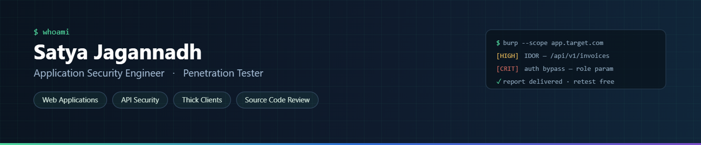

# Hi, I'm Satya Jagannadh 👋

**Application Security Engineer & Penetration Tester — Web Apps · APIs · Thick Clients · Source Code Review**

📍 Hyderabad, India · 13+ years in IT, 7+ in cybersecurity · I break applications (with written permission) and write reports engineers can actually act on.

---

## 🎯 What I do

I help product teams find and fix real vulnerabilities before attackers or auditors do:

| Area | What I look for |
| --- | --- |
| **Web Application Pentesting** | Auth & session flaws, broken access control (IDOR), business-logic abuse, injection, XSS, SSRF — mapped to OWASP Top 10 / WSTG |
| **API Security Testing** | BOLA/BFLA, mass assignment, JWT & OAuth weaknesses, rate-limit and enumeration issues — OWASP API Security Top 10 |
| **Thick Client Testing** | Traffic interception, insecure local storage, hard-coded secrets, DLL hijacking — .NET / Java / Electron |
| **Secure Source Code Review** | Manual review + SAST (Semgrep, CodeQL, SonarQube) for injection, authZ, crypto misuse and secrets in code |

---

## 🚀 Projects

| Project | What it is |
| --- | --- |
| [**XSS Sentinel**](https://github.com/Satya-dvv/xss-sentinel) | Burp Suite extension (Java) that crawls web applications and detects XSS automatically. Submitted to the PortSwigger BApp Store — [extension-portal #387](https://github.com/PortSwigger/extension-portal/issues/387) |
| [**Web App VAPT Guide**](https://github.com/Satya-dvv/webapp-vapt-guide) | Practical OWASP-based web pentesting playbook with Burp Suite examples and report templates |
| **Satya Sec Bot** | Telegram bot (Python) for CVE/CWE lookups and security news — demo on request |

---

## 🧰 Toolbox

- **Testing:** Burp Suite · OWASP ZAP · Nmap · Postman · sqlmap · ffuf · Wireshark
- **Code review:** Semgrep · CodeQL · SonarQube · manual review
- **Languages:** Python · Java · Bash · JavaScript · SQL
- **Standards & frameworks:** OWASP WSTG · ASVS · API Security Top 10 · MITRE ATT&CK · CWE Top 25

---

## 📚 Right now

- 🔬 Working through the PortSwigger Web Security Academy labs — sharpening advanced web/API attack chains
- 🛠️ Improving XSS Sentinel for the BApp Store review
- 🤝 Building an application-security testing team serving clients in the US and India

<!-- CERTIFICATIONS: add only certifications you actually hold, each with a verification link (Credly / Credential.net). Clients and recruiters verify these. -->

---

## 🤝 Let's talk

Open to application-security engagements (web, API, thick client, code review), responsible disclosure collaboration and interesting AppSec problems.

📫 Reach me on [LinkedIn](https://www.linkedin.com/in/satyadvv) or [X](https://x.com/urs_satyadvv)
